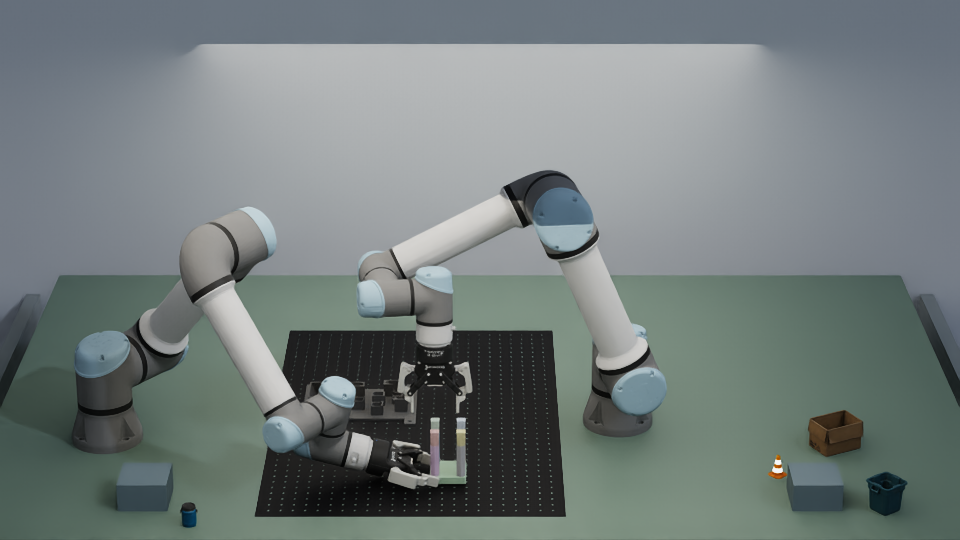

# 观看 Stool 完整装配结果

这里展示的是已完成九件辅助装配的历史成功版本 S24，固定 seed `0`、layout seed `4906`。后来的未完成提速录像没有作为成功结果展示。

- **[正面完整录像](media/observation_images_front.mp4)**：优先查看右臂在画面左侧扶持底座，以及左臂逐件安装、松爪和退避。
- **[左腕完整录像](media/observation_images_left_wrist.mp4)**：查看左臂抓取和安装；部分姿态有遮挡。
- **[右腕完整录像](media/observation_images_right_wrist.mp4)**：查看夹爪与底座的贴合及扶持期间的状态。
- **[三路播放器](results.html)**：将仓库下载到本地后打开，或按下方方式通过浏览器观看。



## 在本地浏览器播放

从仓库根目录启动一个只用于观看文件的本地服务：

```bash
python3 -m http.server 8000 --bind 127.0.0.1
```

打开 **http://127.0.0.1:8000/docs/stool_assisted/results.html**。该服务不启动 Isaac Sim，也不会控制机械臂。GitHub 页面中的 MP4 链接也可以直接打开或下载播放。

## 录像能说明什么

实际完成顺序为 `2 → 3 → 7 → 6 → 4 → 5 → 1 → 0 → 8`，九件均走完安装、释放及对应退避；右臂持续几何扶持覆盖全部 166 个左臂阶段。视频保留原编码，没有为本次合并重新剪成另一条成功轨迹。

安装后的虚拟工装固定支撑仍然保留。末尾观察窗口约 0.3 秒仿真时间，不能据画面宣称凳子撤除支撑后能够自稳或承重。原任务没有增加最终双臂回到 home 的要求。

[原运行复盘](../../artifacts/stool_assisted/round_review.json)记录阶段、扶持和终态数据；[媒体清单](../../artifacts/stool_assisted/media_manifest.json)记录三份完整视频和完成图的大小及 SHA256。
